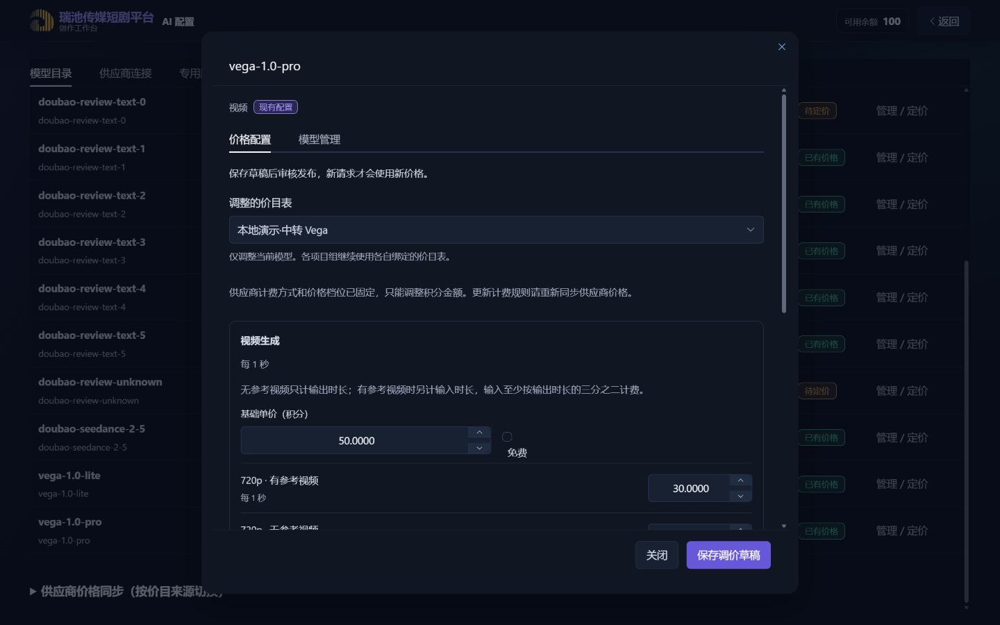
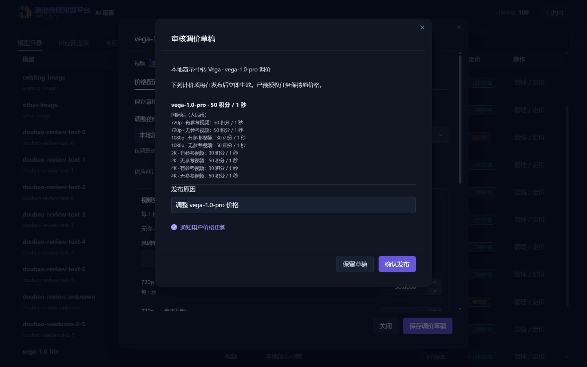

# 供应商价目全链路与 Vega 秒计费本地验收

验收日期：2026-10-29（Asia/Shanghai）。交付范围为本地代码，未提交、推送或部署。

## 结果与行为

- 火山直连与瑞池中转同步页合并显示计费方式，保留供应商原模型 ID；已识别的待审核变更可批量接受，排除项和未知规则不包含在内。
- 从同步价目生成的草稿、已发布价目的复制版本、模型目录调价草稿继承供应商计量规则。前后端均限制只能调整金额；模型、供应商、单位数量、档位条件不能改写或增删。
- 价目列表、编辑器和模型目录发布预览使用中文业务说明与完整单位；条件档位按行展示。独立手工价目保留原有自定义能力。
- Vega 视频按星辰当前的 `video_second` 及站点、分辨率、参考视频条件映射。Pro 参考视频输入按 `max(真实输入秒数, 输出秒数×2/3)` 加到输出秒数；Lite 按真实输入、输出秒数及第 6 张起的参考图结算。
- 金额字符串通过整数运算换算；Vega 的小数秒数只在新规则快照中启用。预授权按已核实模型上限保留，最终不使用请求时长、媒体时长或 Token 估算代替供应商真实用量。缺失真实用量进入待对账，失败释放。
- 完成视频若在结算写入前中断，重启恢复扫描会将新 Vega 按秒授权恢复成可见待对账，重复扫描不重复建案。

## 契约依据与限制

本机中转项目只读核对：`D:/1Code/star_proxy/backend/docs/client-api/vega.md`、`backend/app/vega.py`、`backend/app/provider_relay.py` 及其 Vega 测试。没有读取上游密钥，没有执行真实供应商请求。

目前只启用已核实的五个 Vega 视频模型映射。混合站点、不支持的计量单位、缺失价格和未知维度保持未识别或拒绝调用。此验收不代表新模型全部生成参数、Vega 图片或视觉接口已经完成接入，也不代表当前线上业务 Key 已获模型权限。

## 消费者覆盖

实施前检索 `frontweb/src`、`backend-node/src`、`backend-node/test` 的价目字段、计量单位、条件规则、视频授权与恢复消费者。

| 路径 | 覆盖结果 |
| --- | --- |
| 前端 API、同步审核、批量接受 | `account.js`、`ProviderPriceSyncPanel.vue`；两条渠道走相同固定规则审核 |
| 价目列表、编辑、复制、发布 | `AdminConsole.vue`、共享 `PriceBookItemsEditor.vue`、展示工具；完整保留条件和单位数量 |
| 模型目录、历史版本、调价与发布预览 | `ModelCatalog.vue`；继承规则锁及供应商，预览完整单位 |
| 管理鉴权、路由与候选审核 | `routes/admin.js`、`routes/index.js`、`providerPriceService.js`；沿用管理员权限，批量事务提交 |
| 价目保存、复制、模型调价与发布 | `billingService.js`、`modelCatalogService.js`、`priceBookRuleService.js`、迁移 89；新增规则快照，不重写旧价格 |
| 中转价格解析与模型类别 | `richbestPricingService.js`、`modelCapabilityService.js`；映射已验证秒/输入图及站点，未知规则不猜测 |
| 视频及全能创作报价、预授权 | `routes/videos.js`、`omniVideoService.js`、`relayVideoBillingService.js`；按模型上限及素材冻结 |
| 完成结算、后处理前结算、成本用量、异常与重启 | `videoService.js`、`billingService.js`；按快照启用真实秒数，缺失证据待对账；完成态媒体仍使用本地文件 |
| 待对账列表、人工结算及历史读取 | 沿用案件与账本 API；新增秒规则快照支持小数，旧快照保持原口径 |

## 数据兼容边界

- 新秒计费仅作用于重新同步并人工发布、含 `relay_video_billing_version=1` 的价目生成的新授权。
- 历史已发布价目、历史授权快照、已有账本、已完成媒体和处理中任务不批量改写或重算；旧快照仍走原结算路径。
- 规则快照只在新草稿、复制、调价及后续编辑时捕获；既有派生草稿未来编辑以当时保存的结构为约束。
- 迁移仅新增 `IF NOT EXISTS` 表；重启集成测试重复执行迁移，并验证既有价格和完成媒体仍可读取。

## 验证证据

- 前端全量测试：295 通过、0 失败，最后代码变更后重跑。
- Production build：通过，保留既有大包体积提示。首次并行执行因本机内存不足失败，限制并发后成功；内存失败没有作为代码通过依据。
- 后端相关回归：140 通过、0 失败，覆盖计费、供应商同步、两条渠道价目保护、模型目录、Vega、异步生命周期和重启；在补齐完成后结算前中断恢复后重新执行通过。
- `supplierPriceRules.integration.test.js`：HTTP 鉴权、规则篡改拒绝、金额修改成功、两条渠道发布与复制、模型调价、迁移和重启读取。
- `relayVideoBillingHttp.integration.test.js`：隔离数据库、本地 HTTP 模拟供应商和实际本地 MP4。项目 HTTP 路由发起三次任务，真实返回 6 秒按 6 秒结算、缺失用量待对账、失败释放；重启保留本地媒体且供应商创建数仍为 3。另模拟完成后待对账写入前中断，验证恢复扫描幂等。
- 浏览器实际验收：运营价目页、火山/中转草稿、模型目录调价与发布预览，在 1280×720、1440×900、1920×1080 检查滚动和操作；补查 390×844 窄屏。无页面横向溢出，末尾价格档位可滚动到达，固定底部按钮可操作。大屏截图受内置浏览器显示缩放裁切，辅以 DOM 视口、对话框边界和实际保存操作核对；720/900 高度截图完整可见。
- 浏览器金额操作：中转草稿末尾档位增加 1 积分、保存并重开，确认金额保留；模型目录调价增加档位售价后保存，确认发布预览只改变金额，保留所有条件。

截图为隔离演示价格，不代表真实供应商当前报价：

## 本地演示

访问 `http://127.0.0.1:3013/`。后端为临时 SQLite 的隔离路由 fixture，dev 档，不启动供应商同步或生成恢复后台进程；供应商地址不可达，所有非本机 fetch 另被阻断。页面以“本地演示”标记草稿与已发布演示价目。真实付费调用未执行。
