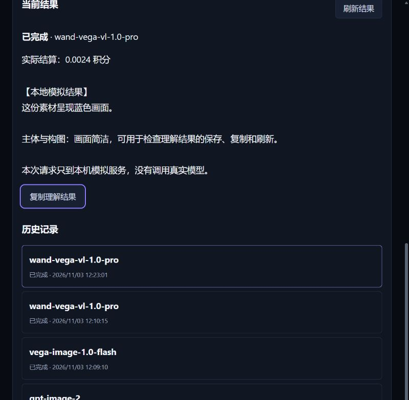

# 瑞池中转图片与素材理解验收

日期：2026-11-03（北京时间）。状态：本地实现与隔离验收完成；未提交、未推送、未部署。代码位于 `D:\1Code\cyl\RichiDrama\.tmp-repo-source`，基线 `eeca7b5e13fcf87e610e0530fca522460ae3fd0d`。原工作区的 Draft 等其他任务未纳入本次工作。方案见 [适配范围](../../plans/2026-11-03-relay-image-vl.md)。

后续按用户要求增加了[真实中转站报价核对](live-pricing.md)，发现并修复 ModelTop 原始维度兼容问题。修复后相关后端 46/46 通过，随后发布前最终完整后端 651/651、前端 299/299 及构建通过；页面代码不变，沿用三档桌面和窄屏证据。

## 实现与适用范围

新增工作台 `/ai-tools/relay-models`，覆盖三款 GPT Image（2、2.5 flare、2.5 sunburst）、三款 Vega Image（lite、flash、pro）、三款 wand-vega-vl（lite、flash、pro）。能力与权限以当前业务 Key 的实时模型目录为准。

GPT 支持文本生成单张/多张图片；Vega 图片支持参考图与异步任务；VL 支持文本及图片、视频、音频、文件素材理解。生成图片完成前必须解码并保存到本地，接入既有图片记录和素材库；理解结果、usage 与历史记录持久化。创建和查询均走鉴权后的项目 HTTP API，未从验收脚本绕过业务链路调用供应商。

价格新增图片输入 Token，区分 GPT 文字输入、图片输入、图片输出及缓存；保留另一个渠道按张计价的明确合约。Vega 图片区分国内/国际站、输出张数、Pro 前三张参考图免费及后续输入；Lite/Flash 的零价参考图规则识别为已包含费用。VL 区分站点、输入/输出/缓存。金额使用既有整数/十进制计算链路，缺失维度不猜价。

新行为只适用于显式 `relay_model_billing_version=1` 的新价目及由新接口创建的任务。需要管理员重新同步、接受并发布新版价目；同步报价不会自动覆盖现有售价。旧模型、已发布旧价目、已有授权快照、已有任务及历史账本不自动升级或重算。新建 Token 价目只在新草稿中排除不兼容的旧 GPT 按张价格，旧父价目保持不变；初始化迁移不会向带新版标记的价目补入每张 40 积分的历史规则。

## 消费者覆盖

| 范围 | 覆盖结果 |
|---|---|
| 模型目录/实时权限 | 模型类型推断、导入配置、目录可见性、当前 Key 的模型与能力查询、项目编辑权限 |
| 价格全链路 | 同步编译、单条/批量接受、新建/复制草稿、校验发布、模型价目编辑、前端单位展示 |
| 计费/成本 | 报价绑定、预授权、真实 usage、缓存去重、缺失用量待核对、明确失败释放、成本账本及查询汇总 |
| API/异步 | 稳定请求 ID、重复及冲突请求、后台执行、原任务查询、凭据绑定、超时退避、重启恢复 |
| 媒体/历史 | 本地图片解码归档、图片列表、素材库、工作台历史、刷新读取、项目删除后本人历史读取 |
| 原图片链路 | 新价目模型引导至工作台；旧图片计费继续原路径；待核对的新任务不能被通用失败/删除路径错误释放 |

检索范围为 `frontweb/src`、`backend-node/src`、`backend-node/test` 的模型名、meter、图片/任务状态、价目、cost 和授权消费者。具体修改文件及 SHA-256 见 [代码清单](code-manifest.json)，不包含副本中原有换行差异或其他任务。

## 自动化验证

| 检查 | 最终结果 | 证据 |
|---|---|---|
| 后端全量 | 651/651 通过，无跳过 | [日志](backend-full.log.gz) |
| 新模型及相关价格/成本专项 | 47/47 通过（属于全量子集） | [日志](backend-targeted.log.gz) |
| 前端全量 | 299/299 通过 | [日志](frontend-tests.log.gz) |
| production build | 通过；保留现有 chunk 体积提示 | [日志](frontend-build.log.gz) |
| Git diff 空白检查 | 通过；存在工作区 CRLF 提示 | 本地执行，无提交 |

后端测试使用隔离数据库、loopback 模拟上游、合成媒体。HTTP 集成覆盖：管理员同步→批量接受→创建新价目→发布→九款模型业务请求；报价变化与缺失确认、并发重复只创建一次、请求冲突、权限拒绝、原任务恢复、实际图片数与成本、输入图片/视频/音频/文件、错误媒体预授权前拒绝、未知提交不重发、缺失 usage 不结算、明确失败释放、归档恢复、Key 改变后不冒用、重复迁移和数据库重开、历史价目及历史记录仍可读。

全量命令为 `node --test --test-concurrency=2 test/*.test.js`；前端为 `node --test test/*.test.js`；构建用 `node node_modules/vite/bin/vite.js build`，与 package 脚本同一构建入口。环境显式配置 Git Bash、ffmpeg/ffprobe 及非隐藏隔离 TEMP，排除了缺少本机工具和 Express 隐藏目录拒绝静态文件造成的验收环境问题。

## 浏览器验收

内置浏览器访问 `http://127.0.0.1:5689/`。该服务仅使用独立演示数据库，供应商地址为本机 `127.0.0.1:5690`，素材为合成图片，无真实密钥、真实供应商或生产数据。

- 实际完成费用确认、GPT 两张图片生成及本地显示；刷新后历史和图片可读。
- Vega 创建后实际重启后端，继续查询持久化的同一个模拟上游任务，完成并保存本地图片；没有再次创建付费任务。
- VL Pro 上传合成参考图，保存理解结果并复制；最新任务显示完成、实际结算 0.0024 演示积分。
- 价格同步界面 24/24 识别、无“暂不支持”，图片输入 Token 采用中文计量标签；模型目录九款均显示已有价格。工具箱新增入口可实际进入工作台。
- 工作台、工具箱、供应商价格、模型目录、价目编辑分别在 1280×720、1440×900、1920×1080 验收；工作台另验 390×844。无页面横向溢出，实际滚动后末尾操作可达，固定区不遮挡按钮，图片加载正常。窄屏到页面底部时提交按钮正常位于上方，可向上滚动回到操作区。

几何证据：[工作台](ui-geometry.json)、[工具箱](toolbox-geometry.json)、[供应商价格](prices-geometry.json)、[模型目录](catalog-geometry.json)、[价目编辑](price-editor-geometry.json)。对应 PNG 保存于本目录。内置浏览器侧栏宽度小于宽屏逻辑视口，宽屏截图捕获范围有限；因此同时使用实际键盘/滚动交互与 DOM 视口、溢出、按钮位置核对，不能仅凭截图判断整幅宽屏布局。

## 限制及验收中发现的问题

真实供应商付费调用未执行，生产模型开通及生产发布未执行。Vega Image Pro 使用超过三张参考图时，若上游终态未提供已确认计费输入张数，结果可保存，但预授权保留待核对；不以提交张数猜测实际扣费。GPT/VL 提交结果未知时不会自动重发。

早期演示上游在重启后复用了模拟 request ID，造成一个演示任务费用待核对；模拟服务已改 UUID，最新 VL 任务结算成功，旧演示账本保留。另一条早期演示价目在初始化时被旧迁移补入按张 40 积分，触发本次兼容修复；旧演示价目未被直接删改，最终 HTTP 测试验证新建/复制价目及再次迁移不会混入旧计费口径。未将旧模拟记录状态冒充为全部结算成功。

交付仅本地实现与验证。未执行 Git 提交、推送或部署；远端 CI 与生产验收不适用于本次本地交付，后续发布仍须按项目门槛执行。
